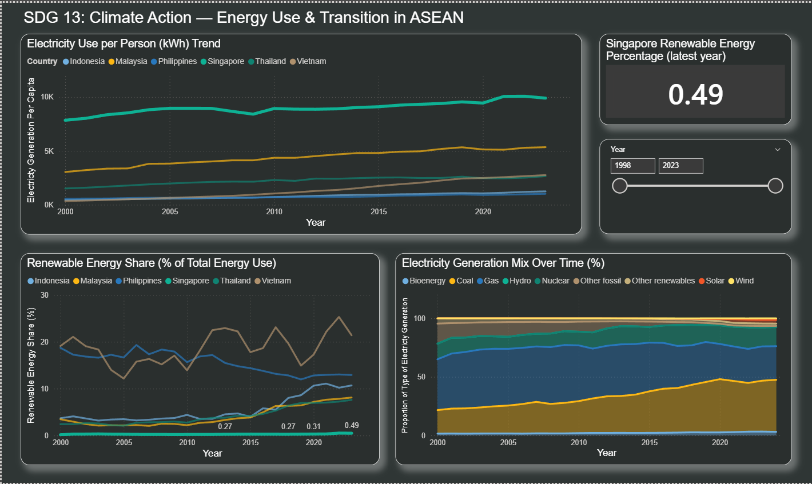

# ASEAN Energy, Economy and Environmental Analytics

Individual academic project · Ngee Ann Polytechnic · Data Discovery and Visualisation · Semester 2 folder, October 2025 coursework

## Business problem

Compare Singapore with selected ASEAN economies to understand patterns in energy demand, renewable adoption, emissions and environmental indicators. The work demonstrates how to combine economic and environmental data for management reporting and exploratory risk discussions.

## Methodology and tools

Power BI and Power Query were used to standardise names and types, filter countries, remove unused columns and unpivot wide time series. Related indicators were merged into country–year tables. Student-created Country and Year dimensions support filtering; some snapshot datasets have different coverage or relationships. DAX measures provide selected-period comparisons, with AI assistance disclosed in the original report.

The three dashboards cover energy use and transition, CO₂ emissions and economy, and environmental impact. [Read the submitted report text](reports/submitted-report.md) for preparation steps and the original narrative.

## Findings and previews

The report describes rising electricity generation per capita, uneven renewable adoption and continued fossil-fuel dependence. Singapore's emissions trend differs from several developing economies in the selected period. These are descriptive findings from the coursework data, not evidence of a causal relationship.

[Emissions and economy preview](assets/emissions-economy.png) · [Environmental impact preview](assets/environmental-impact.png)

Previews are unchanged images extracted from the submitted report, with their original filters and displayed values. A displayed forest-share donut should not be interpreted as each country's national forest coverage: check its aggregation and denominator against the source table. Temperature and emissions patterns alone do not establish causation.

## Files and reproducibility

- `assets/`: three reviewed dashboard screenshots.
- `reports/submitted-report.md`: original narrative, spelling and values preserved; cover and student identifier removed.
- `data/dimensions/`: original `CountryDimensionTable.xlsx` and `YearDimensionTable.xlsx`, inspected for identifiers, external links and connection strings. These are supporting dimension tables, not a retail dashboard.
- `docs/VALIDATION.md`: checks and remaining work.

The original Power BI model was found locally but is not uploaded yet: its compressed embedded DataModel cannot be fully privacy-audited with the available file inspection. Open a copy in Power BI Desktop, inspect Data Source Settings, queries, parameter values and hidden tables, remove local user paths/credentials, and test refresh before publishing a cleaned `.pbix` or `.pbip` export.

Rebuilding requires the original energy, emissions, GDP, population, forest, waste and temperature datasets and Power BI Desktop. The original report lists OWID, Ember, IMF and a World Bank source; its World Bank citation appears to refer to governance indicators, so exact source provenance requires reconciliation. Raw third-party extracts are not redistributed until their terms and versions are confirmed. The dimension workbooks alone cannot refresh the model.

## Limitations and relevance

Coverage, reporting lags, units and selected years differ across sources. Aggregates and slicers must be checked before interpreting a KPI. Findings are educational and descriptive. The project shows data modelling and communication skills useful in banking, risk and business analytics; it does not claim to measure financial risk or provide trading signals.
